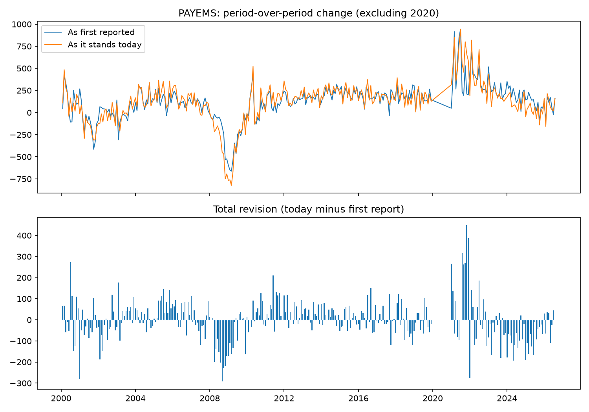

# pit-tracker

A small point-in-time data tracker for macroeconomic time series, built on the Federal Reserve's ALFRED vintage archive.

Economic data gets revised. The payroll number reported on jobs day is often different a month later, and different again after the annual benchmark revision. A backtest that uses today's revised numbers is quietly using information nobody had at the time. This project stores every published version of a series so you can see it exactly as it looked on any past date, checks the history for data quality problems, and measures how large the revisions actually are.

I built it to get hands-on with vintage-aware data, starting with US nonfarm payrolls (`PAYEMS`).

## What it does

- **Sourcing:** pulls series metadata and the full vintage history from the FRED/ALFRED API, with paging and retry/backoff.
- **Storage:** keeps everything in SQLite. One table is a metadata catalog (units, frequency, seasonal adjustment, source update time, fetch time). The other holds every published value with its real-time validity window, keyed on `(series_id, obs_date, realtime_start)`.
- **Point-in-time queries:** `as_of(date)` returns the series exactly as published on that date. `latest()` and `first_release()` give the current and original views.
- **Quality checks:**
  - missing values (FRED publishes `.` for these)
  - calendar gaps in the latest vintage
  - real-time window integrity (no overlaps, exactly one current value per observation)
  - outliers in period-over-period changes, using a median/MAD robust z-score
  - unusually large revisions
  - stale data
- **Revision analysis:** compares each month's change as first reported against the change as it stands today, then writes a markdown report, a chart, and a CSV.

## Quick start

```bash
git clone <repo-url> && cd pit-tracker
python -m venv .venv && source .venv/bin/activate
pip install -r requirements.txt

# Free key: https://fred.stlouisfed.org/docs/api/api_key.html
export FRED_API_KEY=your_key_here

python -m pit_tracker fetch  --series PAYEMS --start 2000-01-01
python -m pit_tracker qc     --series PAYEMS
python -m pit_tracker report --series PAYEMS       # writes output/PAYEMS_report.md
python -m pit_tracker asof   --series PAYEMS --date 2020-06-01 --last 6
```

Any FRED series ID works, for example `GDPC1` (real GDP, quarterly) or `CPIAUCSL` (CPI).

## How the vintage data works

Each ALFRED row says: for this observation date, this was the published value from `realtime_start` through `realtime_end`. Both ends are inclusive. The current value has `realtime_end = 9999-12-31`, which the code treats as open-ended.

To reconstruct what someone saw on a given day, keep the rows whose window contains that day:

```
realtime_start <= date AND (realtime_end >= date OR realtime_end is open)
```

For payrolls, the headline figure is the monthly change, not the level. The "first reported change" for a month is computed from the snapshot on its release day. In that snapshot the prior month has usually already been revised once, which matches how the number is reported in practice.

## Design choices

- **SQLite over flat files:** revision history is naturally relational, and the real-time index keeps `as_of` queries simple. It needs no setup and ports easily to Postgres.
- **Full refresh per series:** each fetch replaces the stored history in one transaction, so reruns are idempotent and a failed run leaves the old data intact.
- **Robust statistics for flags:** median and MAD instead of mean and standard deviation, so a single extreme period like April 2020 doesn't hide everything else.
- **2020 reported separately:** the revision summary is shown with and without 2020, since that year dominates any average.
- **Severity levels:** `error` means the data is structurally wrong, `warning` means review it, and `info` flags real events worth knowing about.

## Project layout

```
pit_tracker/
  fredapi.py       FRED/ALFRED client
  store.py         SQLite schema, load and save
  pointintime.py   as_of, latest, first_release, revision_table
  qc.py            data quality checks
  analysis.py      revision stats, chart, markdown report
  cli.py           command line interface
tests/             unit tests on a small hand-built vintage history
```

Run tests with `pytest`.

## Findings

Results for US nonfarm payrolls, January 2000 to August 2026 (320 months, 321 vintages):

- The typical monthly change has been revised by about **53,000 jobs** (median absolute revision). The mean absolute revision is 73,000.
- Revisions average close to zero (-2,800), so first reports are noisy rather than biased in one direction overall.
- But revisions come in runs. In 2008, first reports were too optimistic and were revised down month after month. 2021 was revised up, and 2023 to 2025 were mostly revised down. Revisions are persistent around turning points, which is exactly when getting the number right matters most.
- In **19 months**, the revision flipped the sign of the change, turning a reported gain into a loss or the reverse.
- The largest revisions were March 2020 (-697k, as the scale of the pandemic shock became clear) and November 2021 (+448k).

All real-time integrity and calendar checks passed. The outlier check flags the 2008 to 2009 recession and the 2020 shock, which are real events rather than data errors.



The full report is in [`output/PAYEMS_report.md`](output/PAYEMS_report.md).

### Example: point-in-time view

What the data looked like on June 1, 2020, compared with today (thousands of jobs):

```
obs                 then         today        diff
2019-11        151,814.0     151,667.0      -147.0
2019-12        151,998.0     151,794.0      -204.0
2020-01        152,212.0     152,031.0      -181.0
2020-02        152,463.0     152,293.0      -170.0
2020-03        151,582.0     150,895.0      -687.0
2020-04        131,045.0     130,426.0      -619.0
```

A backtest run on today's numbers would see a deeper March 2020 drop than anyone saw at the time.

## Next steps

- Parse the release calendar so point-in-time queries align to release times, not just dates
- Separate annual benchmark revisions from routine monthly ones
- Support multiple series in one run, and compare revision behavior across them
- Add seasonal adjustment diagnostics by comparing SA and NSA versions of the same series