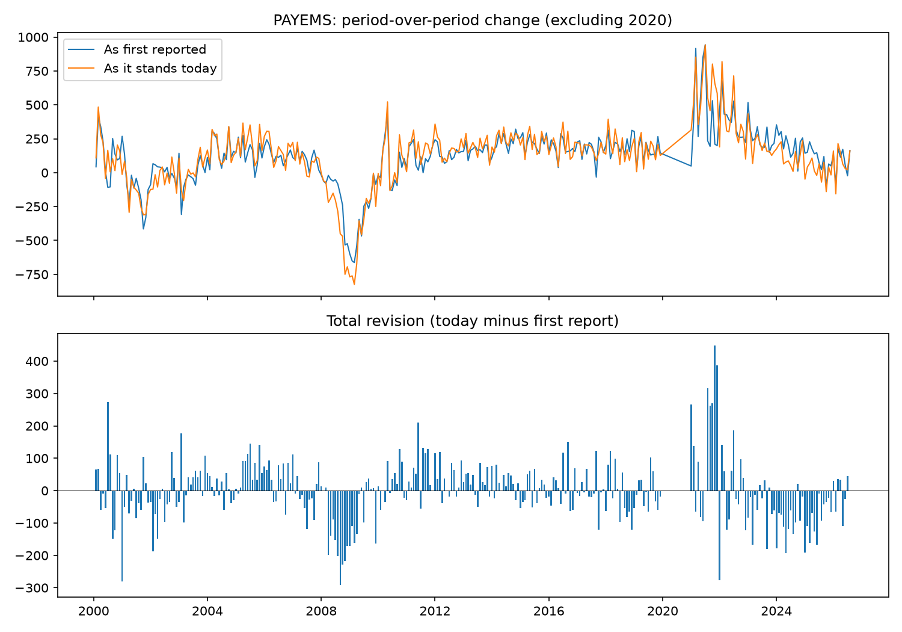

# PAYEMS: point-in-time and revision report

## Metadata

- Title: All Employees, Total Nonfarm
- Units: Thousands of Persons
- Frequency: Monthly
- Seasonal adjustment: Seasonally Adjusted
- Source last updated: 2026-09-04 08:27:34-05
- Fetched: 2026-09-30T07:51:23+00:00

## Coverage

- Vintage rows: 4,114
- Observations: 320 (2000-01 to 2026-08)
- Distinct vintages: 321

## Quality checks

- **info** `outliers`: 14 changes beyond 5.0 robust SDs: 2008-11 (-750), 2008-12 (-694), 2009-01 (-768), 2009-02 (-761), 2009-03 (-824), 2009-04 (-672), 2020-03 (-1,398), 2020-04 (-20,469), 2020-05 (+2,614), 2020-06 (+4,631)
- **warning** `large_revisions`: 2 revisions beyond 5.0 robust SDs: 2020-03 (-697), 2021-11 (+448)

## Revisions: all periods

- Periods compared: 319
- Mean revision: -2.8 (positive means first reports ran low)
- Mean absolute revision: 73.4
- Median absolute revision: 53.0
- Periods where the direction changed after revision: 19
- Largest upward revision: 2021-11 (+448.0)
- Largest downward revision: 2020-03 (-697.0)

## Revisions: excluding 2020

- Periods compared: 307
- Mean revision: -1.6 (positive means first reports ran low)
- Mean absolute revision: 70.4
- Median absolute revision: 53.0
- Periods where the direction changed after revision: 19
- Largest upward revision: 2021-11 (+448.0)
- Largest downward revision: 2008-09 (-292.0)

## Chart

